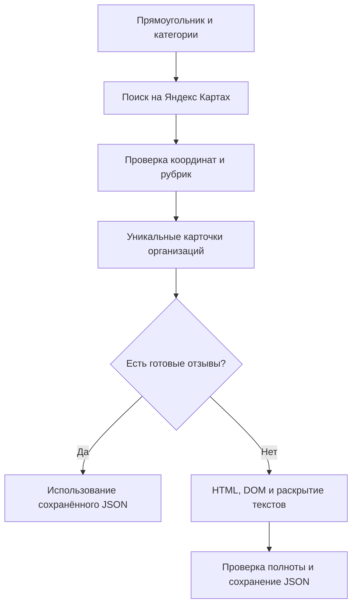

# 📖 Параметры, форматы и диагностика

Короткие примеры запуска и результата находятся в [README](../README.md). Здесь приведены дополнительные параметры и технические сведения.

<a id="установка"></a>

## 🚀 Установка и вызовы Python

- Обычная установка после клонирования: `python -m pip install .`; для разработки: `python -m pip install -e .`. GeoPandas входит в основные зависимости.
- При первом запуске сбора отсутствующий Chromium устанавливается автоматически официальным установщиком Playwright. Уже установленная совместимая версия используется повторно; импорт пакета и чтение сохранённых результатов ничего не скачивают.
- Установка браузера ограничена десятью минутами. При отказе загрузки или доступа к папке кэша сбор прерывается с пояснением; после устранения причины повторите запуск. Параметр `executable` отключает автоматическую установку и использует указанный браузер.
- В Linux при нехватке системных библиотек Chromium выполните `python -m playwright install-deps chromium`; могут понадобиться права администратора.
- В Jupyter/Colab устанавливайте пакет через `%pip` в окружение текущего ядра. Chromium подготавливается автоматически тем же окружением Python.
- В Colab установщик автоматически добавляет `--with-deps`, если отсутствует браузер или его системные библиотеки. Этот режим предусмотрен [документацией Playwright](https://playwright.dev/python/docs/browsers#install-system-dependencies); вне Colab системные пакеты автоматически не меняются.
- Пример установки и вызова: [ноутбук Colab](../examples/colab_quickstart.ipynb). Результаты в `/content` исчезают при удалении среды: скачайте GeoJSON из последней ячейки или задайте папку на подключённом Google Диске.
- `collect_area()` запускает существующий сценарий отдельным процессом того же Python, поэтому синхронный Playwright может работать из Jupyter.
- Дополнительные параметры: `pause=20` (не менее 10 секунд), `scroll_pause=5` (не менее 3), `rate_retries=3` (0–3), `executable=None` (путь к своему Chromium).
- `list_cities()` возвращает имена, псевдонимы, даты и источники доступных городских границ. `list_categories()` возвращает словарь поисковых настроек.
- `result.metadata["review_runs"]` содержит диагностику карточек без дублирования текстов; `review_jobs` — очередь, а после сбора также доступны `run_status`, `returncode` и `city_boundary`.
- Явные `tags` и `queries` заменяют соответствующие настройки конфига; `None` сохраняет выбор карты. Конфиг или GeoJSON можно передать словарём либо путём к файлу.
- `load_results()` читает выбранный лимит из результатов поиска территории без посещения сайта. С `with_reviews=False` старые отзывные файлы не подмешиваются.

## 💾 Экспорт организаций с вложенными отзывами

- `result.to_geojson(confirmed_only=False)` возвращает обычный словарь `FeatureCollection`.
- `result.save_geojson(path, confirmed_only=False)` записывает UTF-8-файл атомарно и возвращает `Path`; папка создаётся при необходимости.
- Каждая организация — отдельный `Feature` со строковым `id`, точкой WGS84 в `geometry` и сведениями в `properties`. При отсутствии координат `geometry` равна `null`.
- `properties.reviews` содержит только отзывы этой организации: тексты, звёзды, даты ISO 8601 в UTC, исходные даты, сведения об авторе и признаки подтверждения. Повторяющийся `organization_id` у вложенных отзывов опущен; связь задаётся родительским объектом.
- Общая оценка находится в `properties.rating`. Состояния, исходные счётчики и `completeness` сохраняются; `exported_reviews` показывает число отзывов именно в выгрузке.
- `confirmed_only=True` фильтрует отзывы, сохраняя все организации. Оно не объявляет исходный частичный снимок полным. Режим фильтрации и ограничения исходного поиска указаны в `metadata` коллекции.
- Пропуски сохраняются как `null`, даты — строками; координаты и тексты не округляются и не сокращаются. GeoPandas для записи не требуется.

Вложенные свойства допустимы в GeoJSON. В ГИС массив `reviews` может отображаться как JSON-строка; в Python он читается обычным `json.load()`. Экспорт содержит отдельный объект каждой организации в одном файле, а не отдельный файл на организацию.

## 📍 Проверка GeoJSON

Координаты — WGS84, долгота и широта, без высоты и поля `crs`. Метрические координаты сначала преобразуйте. Файл ограничен 10 МБ, вся граница — 200 000 вершин. Контуры должны быть замкнуты, без самопересечений, с корректными отверстиями и ненулевой площадью. Геометрия не упрощается и не исправляется автоматически; переход через 180-й меридиан не поддерживается. Если конфиг содержит `geometry` и `bbox`, их границы должны совпадать. Пример формата: [area.example.json](../area.example.json).

## 🏙️ Локальный каталог границ

В комплекте находятся **Москва и Санкт-Петербург**, административные границы из файловой выгрузки OSM [missinglink/osm-boundaries](https://github.com/missinglink/osm-boundaries). Это **архивный снимок за 8 декабря 2016 года**, а не подтверждённые актуальные границы. Дата показывается до выбора города и сохраняется в конфиге. Для текущего исследования проверьте границу и при необходимости загрузите более свежий GeoJSON. Москва здесь означает территорию города федерального значения, включая отдельные контуры, а не только участок внутри МКАД.

Поиск города работает по названию и вариантам написания из `boundaries/catalog.json`, без Nominatim, Overpass или другого геокодирующего API. Он ограничен содержимым каталога. Файлы контуров загружаются только после выбора города; все границы сразу не читаются.

Чтобы добавить город, поместите его полигональный GeoJSON в `boundaries/` и добавьте запись в `cities` файла `boundaries/catalog.json`. Укажите уникальный `id`, `name`, понятный `label`, список `aliases`, относительный `file`, дату снимка `snapshot` и ссылку `source_url`. Для пути используйте латинские строчные буквы, цифры и дефисы: например, `boundaries/tomsk.geojson`. Проверьте файл командой `python test_geometry.py -v`. После перезагрузки страницы новая запись появится в поиске. Нужную границу также можно загрузить через интерфейс, не изменяя каталог.

Данные границ имеют отдельную лицензию ODbL 1.0 и указание источника © OpenStreetMap contributors; подробности — в [описании каталога](../boundaries/README.md).

## 🔎 Как проверяется поисковая выдача

Поисковая страница получает центр и размер выбранного участка, но эти параметры не гарантируют строгие границы выдачи. Поэтому модуль дополнительно проверяет фактические координаты каждой найденной организации. Если они неизвестны, объект не попадает в очередь отзывов; центр области вместо координат организации не подставляется.

Кандидаты сохраняются с полем `selection_status`: `accepted`, `outside_bbox`, `outside_polygon`, `missing_coordinates`, `rubric_mismatch` или `missing_rubrics`. В `organizations` попадают только принятые записи, подтверждённые текущим посещением страницы. Дубликаты между категориями объединяются по идентификатору Яндекса; `found_by` содержит категории или запросы, по которым найден объект. При ограничении новой попытки прежние кандидаты сохраняются с `seen_in_current_run = false` и не передаются сборщику отзывов автоматически.

Охват обозначается как `visible_search_results_only`. Модуль собирает доступную поисковую выдачу и **не гарантирует полный перечень организаций территории**. Географические границы проверяются по точке организации: внутри полигона либо на его границе, вне внутренних отверстий; полнота каталога — отдельная задача. Автоматическое разбиение большой области на участки в эту версию не входит.

| Файл внутри `--output` | Содержание |
|---|---|
| `organizations.json` | Объединённый список организаций, границы и состояния поисковых заданий |
| `search/<ключ>.json` | Кандидаты, причины исключения, параметры и сетевые показатели одного поиска |
| `reviews/<идентификатор>.json` | Полный сбор отзывов найденной организации при `--with-reviews` |
| `reviews/<идентификатор>.limit50.json` | Выборка до 50 свежих отзывов при заданном лимите; число в имени соответствует лимиту |
| `review_jobs.json` | Краткие итоги карточек, фактически обработанных при последнем запуске |

Файлы исходного запуска `collect_yandex.py` сохраняются непосредственно в его `--output`; поиск через `discover_yandex.py` использует вложенную папку `reviews/`.

| Параметр поиска | По умолчанию | Назначение |
|---|---|---|
| `--bbox` | Не задан | Четыре границы области; имеет приоритет над файлом |
| `--config` | Не задан | Экспортированный JSON выбора территории и категорий |
| `--geometry` | Не задан | Отдельный локальный GeoJSON с точной границей; имеет приоритет над geometry из конфига |
| `--categories` | Из конфига или пустой список | Ключи либо русские названия предустановок |
| `--query` | Из конфига или пустой список | Свободный запрос; параметр можно повторять |
| `--list-categories` | Выключен | Показать предустановки без браузера и сети |
| `--max-orgs` | `20` | Максимум принятых организаций **на запрос**, от 1 до 100 |
| `--with-reviews` | Выключен | Передать найденные карточки сборщику отзывов |
| `--review-limit`, `--max-reviews` | Все отзывы | Необязательный положительный максимум свежих отзывов каждой организации |

Параметры `--output`, `--pause`, `--scroll-pause`, `--429-retries`, `--executable` и `--refresh` имеют тот же смысл, что у отдельного сборщика отзывов. Поисковые статусы: `capped` — достигнут заданный объём; `visible_results_exhausted` — три прохода не дали новых идентификаторов; `time_budget` и `scroll_budget` — достигнут бюджет попытки. Ошибка, CAPTCHA или 429 не считаются отсутствием организаций. При ограничении доступа последующие запросы и сбор отзывов останавливаются.

## 🔗 Как передать организации

Можно использовать обычную ссылку из адресной строки Яндекс Карт. Параметры после `?` не требуются. Ссылку заключайте в кавычки.

```powershell
# Передаём ссылку на страницу отзывов и повышаем лимит до 150.
.\.venv\Scripts\python.exe collect_yandex.py "https://yandex.ru/maps/org/-/44307431220/reviews/" --limit 150
# Последовательно собираем две карточки с паузой 30 секунд между ними.
.\.venv\Scripts\python.exe collect_yandex.py 44307431220 1245233699 --limit 150 --pause 30
# Обновляем ранее завершённый результат, повторно открывая страницу.
.\.venv\Scripts\python.exe collect_yandex.py 44307431220 --limit 150 --refresh
# Сохраняем результаты в выбранную папку.
.\.venv\Scripts\python.exe collect_yandex.py 44307431220 --output "my_reviews"
```

Отдельный `collect_yandex.py` принимает HTTPS-ссылки на карточки организаций с доменами `yandex.ru` и `yandex.com`, а также числовые идентификаторы. Сокращённую ссылку сначала откройте в обычном браузере и скопируйте полный адрес. Для автоматического получения карточек используйте `discover_yandex.py`.

## ⚙️ Параметры

| Параметр | По умолчанию | Назначение |
|---|---|---|
| `urls` | Обязателен | Одна или несколько ссылок либо числовых идентификаторов |
| `--limit`, `--max-reviews` | Все отзывы | Необязательный положительный максимум свежих отзывов на каждую организацию |
| `--output` | `review_results` | Папка JSON-файлов; одновременно используется для возобновления |
| `--pause` | `20` | Пауза между открываемыми карточками, секунды; не менее 10 |
| `--scroll-pause` | `5` | Пауза после прокрутки, секунды; не менее 3 |
| `--429-retries` | `3` | Число повторов после исходной попытки с HTTP 429; от 0 до 3 |
| `--refresh` | Выключен | Повторно открыть карточки с готовым сохранённым результатом |
| `--executable` | Не задан | Путь к исполняемому файлу установленного Chromium |
| `--help` | — | Показать справку |

Без `--limit` или `--review-limit` программа пытается собрать все доступные текстовые отзывы. При значении `50` выбираются **до 50 самых свежих отзывов каждой организации**; если отзывов меньше, собираются все имеющиеся. Ноль и отрицательные значения отклоняются. Лимит не относится к сумме отзывов всех организаций.

Если отзывов больше лимита, сборщик выбирает «По новизне» через меню страницы и проверяет даты видимых записей. Если порядок нельзя подтвердить, результат получает `sort_unavailable`: популярная выдача не выдаётся за свежую. Для полного сбора больших карточек также выбирается «По новизне»: выдача «по умолчанию» может перестать подгружать данные раньше счётчика. Небольшие карточки до 50 отзывов можно упорядочить локально; все полученные записи сохраняются от свежих к старым по доступным датам. Это даты, отображаемые источником, включая возможные обновления отзывов.

```powershell
# Собираем все доступные отзывы одной организации.
.\.venv\Scripts\python.exe collect_yandex.py 44307431220
# Получаем до 50 самых свежих отзывов организации.
.\.venv\Scripts\python.exe collect_yandex.py 44307431220 --max-reviews 50
# Получаем до 50 самых свежих отзывов каждой найденной организации.
.\.venv\Scripts\python.exe discover_yandex.py --config area.json --with-reviews --max-reviews 50
```

Статус `capped` означает достижение заданного максимума, а не полное число отзывов организации. Полный сбор не ограничен 300 записями, 25 прокрутками или 240 секундами; большое число отзывов потребует больше времени. Ошибки доступа и три ожидания без новых карточек завершают попытку с сохранением данных. Проверяйте итоговый статус: отсутствие лимита не превращает частичный результат в полный.

## 🔄 Загрузка и возобновление



Программа сначала проверяет JSON: организацию, версию формата, уникальность ключей, наличие текста и даты, целую оценку 1–5 и отсутствие сокращённых текстов. Результат `complete` используется повторно, если число записей соответствует сохранённому счётчику. Результат `capped` используется только для ограниченного сбора с подтверждённой сортировкой по новизне. Для полного сбора он не подходит. Готовый полный снимок позволяет создать меньшую свежую выборку локально, без браузера; собственный файл выборки хранится отдельно. Старый ограниченный кэш без подтверждения сортировки потребует нового посещения. Если все карточки уже готовы, браузер вообще не запускается.

При незавершённом сборе повторите ту же команду с той же папкой `--output`. Страница откроется заново, а сохранённые полные тексты помогут избежать повторного раскрытия. Это повторный проход по странице, а не продолжение с конкретной позиции прокрутки. При успешном завершении в снимке остаются отзывы, подтверждённые текущим DOM. При остановке сохраняется накопленный прогресс, который может включать записи предыдущей попытки.

`--refresh` повторно посещает карточку, сохраняя возможность использовать уже полученные тексты. Для полностью нового снимка укажите другую папку `--output`. Файл кэша является снимком: без обновления новые отзывы на сайте не проверяются. Повреждённый JSON или неверная структура автоматически перемещаются в соседний файл `имя.broken-<время>.json`; оригинал сохраняется, а сбор начинается заново. Несовместимая версия формата или чужой идентификатор требуют отдельной папки результатов.

Запись выполняется через уникальный временный файл в той же папке, синхронизацию с диском и атомарную замену итогового JSON. При отказе записи прежний файл остаётся целым. Одна папка защищена системной блокировкой `.run.lock`: второй запуск получает понятную ошибку. После аварийного завершения процесса блокировка освобождается автоматически; удалять файл вручную не требуется. Разные папки этой блокировкой не связаны — запускайте сетевой сбор последовательно.

Файл `review_jobs.json` содержит состояние очереди, итоги попыток, `remaining_ids` — ещё не обработанные или прерванные карточки, и `retry_ids` — уже открывавшиеся карточки с незавершённым результатом. `finished` означает, что очередь попыток завершена: проверяйте статусы отдельных результатов, поскольку среди них возможны ошибки или неполные поля. `stopped`, `interrupted` и `error` обозначают остановку; `cache_hit` — полностью готовый поисковый запуск из кэша. Для возобновления повторите прежнюю команду: готовые снимки будут пропущены, остальные проверены снова.

## 📦 Что находится в JSON

| Поле | Содержание |
|---|---|
| `schema_version` | Версия формата; сейчас `1` |
| `organization_id`, `url`, `final_url` | Организация, исходный и конечный адрес страницы |
| `collected_at` | Время начала последней попытки в UTC |
| `status`, `limit` | Состояние обработки и заданный максимум; `null` означает отсутствие лимита |
| `review_order` | Подтверждённый порядок `newest` для готового результата |
| `cache_source` | `complete_snapshot`, если ограниченная выборка создана из полного кэша без посещения сайта |
| `company` | Название, адрес, координаты, категории, общая оценка и счётчики |
| `reviews` | Отзывы: `id`, `author`, `author_url`, `date`, `text`, `rating`, `text_truncated` |
| `observation` внутри отзыва | `dom` — запись показана страницей, `html` — найдена только во встроенном текущем HTML, `previous_snapshot` — сохранена из прежнего файла |
| `full_text_confirmed` внутри отзыва | Полный текст прочитан из HTML или раскрытого DOM при последней попытке; одного совпавшего короткого начала недостаточно |
| `source_review_id` внутри отзыва | Исходный идентификатор из встроенного HTML, если доступен |
| `valid_reviews`, `truncated_count`, `invalid_rating_count` | Число полных записей, сокращённых текстов и нераспознанных оценок |
| `observed_this_run`, `observed_in_dom` | Число уникальных записей, найденных при последней попытке в HTML/DOM и отдельно в DOM |
| `unconfirmed_saved_reviews` | Прежние записи, не найденные заново при последней попытке; частичный файл может содержать такие записи |
| `confirmed_full_texts` | Число сохранённых записей, полный текст которых подтверждён при последней попытке |
| `completeness` | Состав файла по источникам подтверждения, числовые расхождения и `ready_as_cache` |
| `dom_cards_in_last_batch`, `duplicate_dom_cards_in_last_batch` | Число физических карточек и повторов в последней прочитанной порции; накопленный объём DOM считается отдельно |
| `stall_diagnostics` | При остановке: счётчик сайта, число записей файла, число подтверждённых в DOM и число ожиданий без прогресса |
| `elapsed_seconds`, `scrolls`, `expanded_texts` | Длительность последней попытки, число прокруток и раскрытых текстов |
| `network`, `attempts` | Счётчики запросов, отменённые ресурсы, HTTP-ошибки, отказы без HTTP-ответа (`failures`), незавершённые загрузки (`pending_loads`) и журнал попыток |

Координаты `company.coordinates_lon_lat` записываются как **[долгота, широта]**. Счётчик `ratings_count` включает оценки без текстового отзыва; его нельзя использовать как ожидаемое число записей `reviews`.

`reviews[].rating` — оценка конкретного отзыва. Общая оценка организации находится в `company.rating`. Если оценка отзыва не распознана, сохраняется `null`, без подстановки общего рейтинга.

`reviews[].id` — локальный SHA-256 ключ из организации, автора и даты; при отсутствии автора или даты дополнительно используется текст без пробелов по краям. Надпись интерфейса «Анонимный отзыв» считается отсутствующим именем, чтобы HTML и DOM давали один ключ. Он нужен для объединения записей, а не является исходным идентификатором Яндекса. Изменение даты или профиля может изменить этот ключ. Даты сохраняются в виде, полученном со страницы, без дополнительного пересчёта часового пояса. Недоступные сведения об организации могут отсутствовать или иметь значение `null`.

Внешние пробелы текста удаляются одинаково для HTML и DOM; пробелы и переносы внутри текста сохраняются. При раскрытии отзыва без профиля ключ пересчитывается по полному тексту. При восстановлении прежних частичных файлов одинаковые полные версии с разными старыми ключами объединяются.

<a id="статусы-и-диагностика"></a>

## 🚦 Статусы завершения

| Статус | Значение и следующее действие |
|---|---|
| `complete` | Все подтверждённые отзывы имеют обязательные поля, число совпало со счётчиком; также возможна карточка с нулём отзывов |
| `capped` | Получен заданный лимит полных отзывов; для большего объёма повысьте `--limit` |
| `count_mismatch` | Число найденных записей превышает счётчик страницы; записи сохранены, расхождение требует проверки |
| `incomplete_fields` | Достигнут счётчик или лимит, но у части записей нет полного текста, даты или оценки |
| `rate_limited` | Сайт вернул HTTP 429; после исчерпания повторов очередь остановлена |
| `captcha`, `access_denied` | Проверка пользователя или отказ в доступе; очередь остановлена |
| `stalled` | Три ожидания подряд не дали новых уникальных отзывов; готовность не подтверждена |
| `load_timeout` | Необходимая загрузка ещё выполняется после трёх ожиданий без новых записей; повторная прокрутка не запускается, очередь остановлена |
| `network_error` | Отказ открытия или подгрузки без HTTP-ответа; снимок сохранён, очередь остановлена. После восстановления сети повторите ту же команду |
| `sort_unavailable` | Нельзя подтвердить выбор самых свежих отзывов; попытка сохранена как незавершённая |
| `server_error` | HTTP 5xx при открытии или необходимой подгрузке; снимок сохранён, очередь остановлена |
| `timeout`, `error` | Ошибка ожидания либо другая ошибка; подробности доступны в JSON |
| `not_found`, `http_error` | HTTP 404/410 либо другая ошибка открытия карточки |
| `browser_closed` | Браузер или вкладка закрылись; очередь остановлена |
| `interrupted` | Сбор прерван пользователем; накопленные данные сохранены |
| `running` | Промежуточный файл; обработка ещё идёт либо процесс завершился без финальной записи |

В терминале также встречается `cache_hit`: готовый файл использован без посещения сайта. Это событие, а не новый статус внутри сохранённого JSON. Для автоматической обработки проверяйте и поле `status`, и код завершения: `0` — все запрошенные попытки готовы; `1` — ошибка или незавершённый результат; `2` — неверные параметры; `130` — прерывание пользователем. У готового поиска возможен статус `visible_results_exhausted`: это исчерпание наблюдаемой выдачи, а не доказательство полноты городского каталога.

### 🔎 Как читать частичный результат

Счётчик сайта и размер смешанного файла могут различаться. В файле остаются текущие отзывы и прежние неподтверждённые записи, явно разделённые `observation`. Совпадение сокращённого начала не подтверждает полный старый текст. Если повторно прочитать его не удалось, `full_text_confirmed` остаётся `false`.

Числовые разности в `completeness` не доказывают потерю ровно такого числа отзывов: актуальность прежних записей неизвестна. Для анализа используйте `confirmed_reviews()`. При ограниченной проекции полного кэша состав пересчитывается, но время относится к исходному посещению. Для новых признаков подтверждения в старом файле выполните сбор с `refresh=True` или `--refresh`.

## ⏱️ Паузы и ограничения сайта

После HTTP 429 повторное открытие выполняется через 60, 120 и 240 секунд. При наличии `Retry-After` используется большая из этих задержек. Если сервер требует ждать более 900 секунд, программа сохраняет результат и завершает очередь, не отправляя преждевременный повторный запрос. CAPTCHA автоматически не решается.

При открытии карточки отзывов после таймаута или HTTP 502/503/504 допускаются ещё две попытки с паузами 30 и 60 секунд. Ошибка открытия географического поиска сохраняется без такого повтора; после восстановления доступа повторите команду. Одна вкладка и одна сессия используются для всей очереди. User-Agent содержит фактическую версию Chromium с обозначением Chrome. Изображения, шрифты и видео не загружаются; сценарии, стили и текстовые ресурсы страницы остаются доступны.

Паузы уменьшают частоту обращений, но не гарантируют снятия ограничения или отсутствия блокировки IP. Условия доступа могут меняться; успешная загрузка нескольких карточек не подтверждает устойчивость массового сбора. Ожидания отдельных действий и число технических повторов ограничены; продолжительность полного сбора зависит от числа отзывов. `elapsed_seconds` относится к последней попытке и не включает паузы между попытками и организациями.

## 🧩 Файлы и изменение селекторов

| Файл | Назначение |
|---|---|
| `collect_yandex.py` | Запуск, браузерный сбор, прокрутка, объединение и сохранение |
| `discover_yandex.py` | Поиск по территории, проверка рубрик и передача карточек сборщику отзывов |
| `categories.json` | Предустановки поисковых категорий с проверяемыми рубриками |
| `select_area.html`, `area_selection.js` | Карта выбора территории, импорт GeoJSON, поиск города и экспорт конфига |
| `area_geometry.py` | Полная проверка топологии, объединение частей и подготовленный пространственный отбор |
| `boundaries/` | Локальный каталог городов, файлы границ, источники и лицензия данных |
| `area.example.json` | Пример формата экспорта территории и категорий |
| `extract_saved_html.py` | Извлечение первой порции отзывов из HTML средствами стандартной библиотеки |
| `storage.py` | Атомарная запись, проверка снимков и системная блокировка папки |
| `test_resilience.py` | Проверки отказов, восстановления и журнала очереди |
| `docs/RELEASE_TESTS.md` | Реальный сбор по Фрязино, найденные ошибки и проверка перед выпуском |
| `test_reviews.py` | Автономные проверки на вымышленных данных |
| `test_discovery.py` | Автономные проверки поиска и связки со сборщиком отзывов |
| `test_limits.py` | Проверки полного сбора, свежих выборок, раздельного кэша и параметров лимита |
| `test_deep.py` | Отключение сети Chromium, восстановление, обновление состава, ключи и повтор видимости |
| `test_pipeline.py` | Прогресс, ошибки загрузки, происхождение записей, подтверждение текстов и частичные снимки |
| `page_loads.py` | Общий учёт начала, завершения и отказа загрузок по метаданным браузера |
| `browser_setup.py` | Общий запуск Chromium и автоматическая установка отсутствующей версии |
| `test_browser_setup.py` | Проверки повторного использования браузера, установки и отказов |
| `test_geometry.py` | Проверки полигонов, отверстий, каталога, кэша и конфига |
| `requirements.txt` | Зависимости Playwright, Shapely, Pandas и GeoPandas |
| `pyproject.toml` | Установка пакета со всеми зависимостями Python |
| `api.py`, `__init__.py` | Импортируемые функции и связанные таблицы результата |
| `test_api.py` | Проверки пакета, таблиц, справочника и фильтра категорий |
| `docs/PERFORMANCE.md` | Результаты проверки корректности и производительности |

Селекторы DOM находятся в `CARDS`, `EXTRACT` и двух сценариях раскрытия и прокрутки внутри `collect_yandex.py`. Чтение встроенного состояния `script.state-view` находится в `extract_saved_html.py`. После изменения разметки сайта обновите соответствующий блок, выполните автономные проверки и проверьте одну карточку с полным текстом и индивидуальными оценками.

Вспомогательный модуль можно вызвать отдельно для сохранённой HTML-страницы:

```powershell
# Извлекаем только встроенную порцию отзывов из локального HTML, без сети.
.\.venv\Scripts\python.exe extract_saved_html.py page.html 44307431220 --output first_batch.json
```

HTML может содержать только первую порцию отзывов. Этот вызов не прокручивает страницу и не загружает продолжение.

При разработке изучались публичные примеры [yandex-reviews-to-md](https://github.com/baslie/yandex-reviews-to-md) и [ymrp](https://github.com/MironBerch/ymrp). Сбор и сохранение реализованы самостоятельно.
